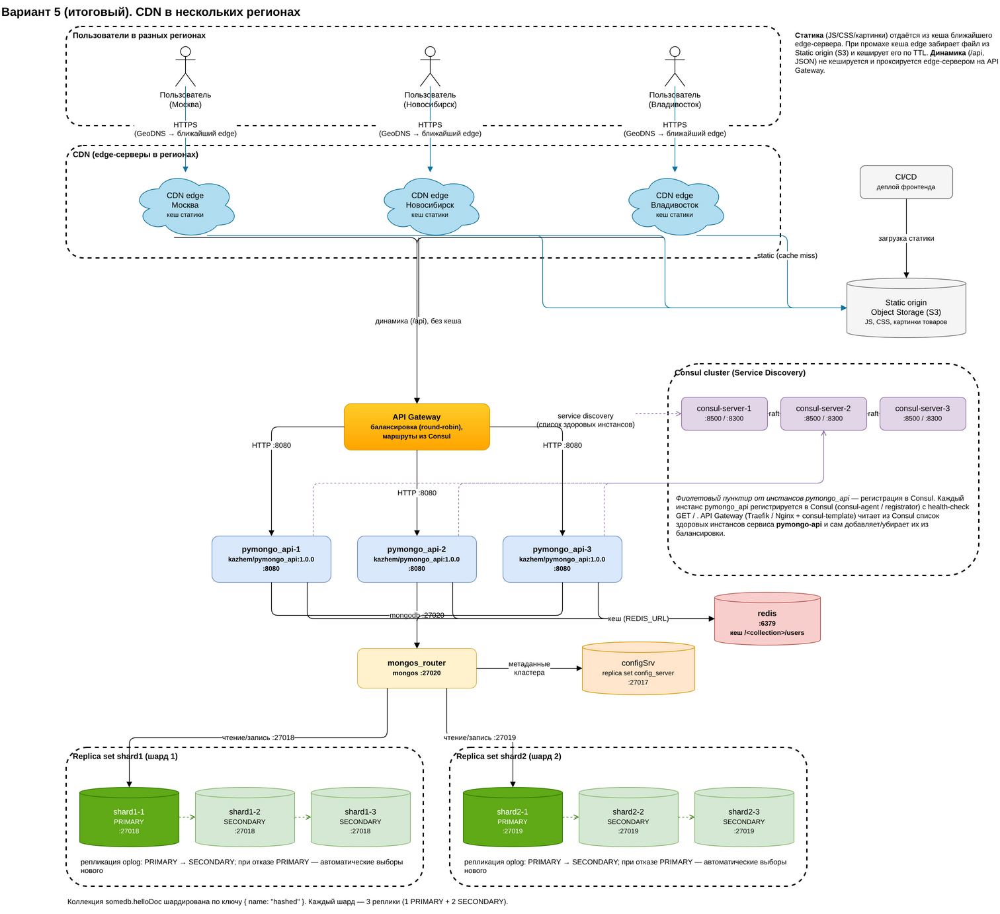

# Мобильный мир: подготовка к «чёрной пятнице»

Проектная работа 4 спринта: шардирование, репликация и кеширование MongoDB, плюс схемы горизонтального масштабирования (API Gateway + Consul) и CDN.

## Структура репозитория

| Путь | Что внутри |
|---|---|
| `architecture.drawio` | Схемы архитектуры, 5 вкладок: шардирование → репликация → кеширование → API Gateway + Consul → CDN. **Итоговая схема — вкладка «5. CDN (итоговая схема)».** |
| `architecture.png` | Итоговая схема (вкладка 5) картинкой |
| `mongo-sharding/` | Задание 2: MongoDB с двумя шардами |
| `mongo-sharding-repl/` | Задание 3: два шарда, в каждом по 3 реплики |
| `sharding-repl-cache/` | **Задание 4, финальный стенд:** шарды + реплики + Redis-кеш |
| `compose.yaml`, `api_app/`, `scripts/` | Исходный стенд (одна нода MongoDB), оставлен без изменений |

## Итоговая схема



## Как запустить финальный стенд

Нужны Docker с Compose v2, минимум 2 CPU и 4 ГБ RAM. Порт 8080 должен быть свободен.

```shell
cd sharding-repl-cache
docker compose up -d          # поднимает 10 контейнеров
./scripts/mongo-init.sh       # настраивает репликацию и шардирование, заливает 1000 документов
```

Скрипт занимает около 30 секунд и в конце печатает состояние всех реплик:

```
    shard1-1 [PRIMARY]: 492 документов, реплик в наборе: 3
    shard1-2 [SECONDARY]: 492 документов, реплик в наборе: 3
    shard1-3 [SECONDARY]: 492 документов, реплик в наборе: 3
    shard2-1 [PRIMARY]: 508 документов, реплик в наборе: 3
    shard2-2 [SECONDARY]: 508 документов, реплик в наборе: 3
    shard2-3 [SECONDARY]: 508 документов, реплик в наборе: 3
```

Статус сервисов: `docker compose ps`.

## Как проверить

Откройте http://localhost:8080 (на виртуальной машине — `http://<ip>:8080`, ip узнать через `curl --silent http://ifconfig.me`). В JSON:

- `"mongo_topology_type": "Sharded"`: приложение работает через роутер `mongos`;
- `collections.helloDoc.documents_count`: `1000`;
- `shards`: два шарда, у каждого по 3 реплики:
  `"shard1": "shard1/shard1-1:27018,shard1-2:27018,shard1-3:27018"`;
- `"cache_enabled": true`: кеш в Redis включён.

Скорость кеша: первый вызов около 1 с, повторные быстрее 100 мс.

```shell
for i in 1 2 3; do curl -s -o /dev/null -w "вызов $i: %{time_total}s\n" http://localhost:8080/helloDoc/users; done
```

Swagger: http://localhost:8080/docs

Подробные шаги настройки (команды для каждого шага и проверка количества документов на шардах) описаны в [`sharding-repl-cache/README.md`](sharding-repl-cache/README.md).

## Остановка

```shell
cd sharding-repl-cache
docker compose down -v
```
